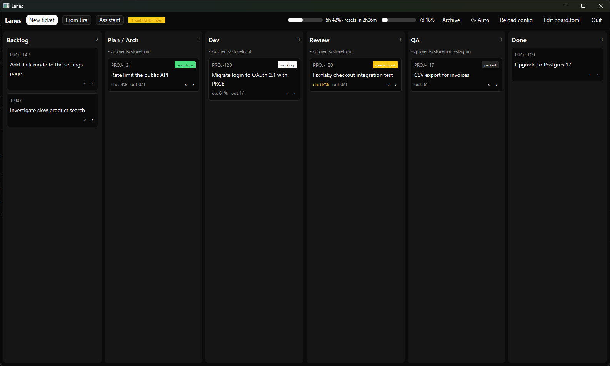
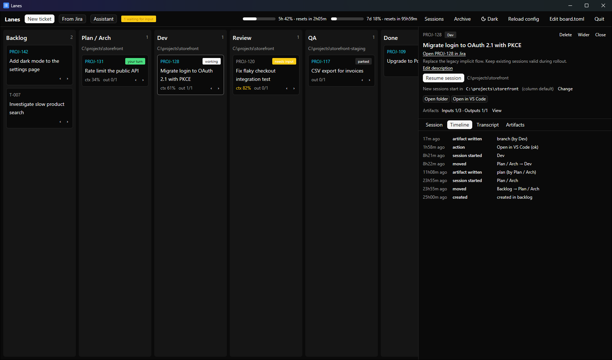

<h1 align="center">Lanes</h1>

<p align="center">
  <strong>A kanban board for real, interactive Claude Code sessions.</strong><br>
  Each ticket gets its own Claude session per stage: plan, dev, review, QA. Stages hand work to each other through small, explicit artifacts, never through a shared transcript.
</p>

<p align="center">
  <a href="https://github.com/kyle-at-bunny/lanes/actions/workflows/ci.yml"></a>
  <a href="LICENSE"></a>
  
  
</p>

<p align="center">
  
</p>

## Why Lanes?

Long Claude Code conversations drift. A session that planned a feature carries all of that exploration into implementation, then into review, filling its context and blurring its judgement. Lanes gives every stage of a ticket its own focused session:

- **Planning** sees the ticket and the codebase.
- **Dev** sees the agreed `plan.md`, not the planning conversation.
- **Review** sees the plan and the branch, and reviews it with fresh eyes.

When a ticket moves *back* (review found problems, say), Lanes **resumes the earlier session for that stage** instead of starting over, and tells it what changed.

Lanes is a task manager, not an autopilot. You decide when a ticket moves. Every session is the real `claude` CLI running in an embedded terminal, so you can talk to it, approve tools, and use slash commands exactly as you would in your own terminal.

## Features

- **One session per ticket per stage.** Each column has its own prompt template, working directory, model and permission mode. Sessions resume by ID when a ticket comes back.
- **Explicit hand-offs.** Columns declare the artifacts they `consume` and `produce`: a markdown file or a short piece of text. Each new session gets the ticket brief and its inputs as context and waits for your first message (or starts straight away with `start = "prompt"`). Lanes warns you if you move a ticket on before its outputs exist.
- **Artifacts tab.** A stage's inputs and outputs, who wrote each one and when, markdown rendering, inline editing of text artifacts, clickable PR links and repo folders, and PR state and CI results via `gh` (with a card badge like "2 PRs · 1 failing").
- **Embedded terminal.** Each `claude` session runs in a GPU-rendered terminal backed by ConPTY and `alacritty_terminal`, with selection, scrollback and bracketed paste. If you'd rather use Windows Terminal tabs, set `terminal = "external"`.
- **Live status at a glance.** Cards show whether a session is working, needs input or is waiting on you, plus its context-window usage. The top bar tracks your 5-hour and weekly plan limits.
- **Board assistant.** A dedicated Claude session that can operate the board for you: create and move tickets, add a column, rewrite a stage's prompt. Config changes hot-reload.
- **Jira import.** Turn issue keys, or your open issues, into tickets. The issue key appears as a link on the board card, the ticket panel links to the issue, and the link is passed to Claude. No API token is needed if the board assistant has Jira tools (e.g. an Atlassian MCP server).
- **Editable tickets.** The ticket panel shows the full description, scrolling when it's long, with **Edit description** to change it in place.
- **Timeline and transcripts.** See a ticket's moves, sessions, artifact writes and actions, and read any stage's conversation without reviving it.
- **Flexible working folders.** A column's folder can be a template, e.g. one git worktree per ticket. Any ticket can override it for all stages or just one.
- **Action buttons.** Templated one-click commands per column or board-wide, such as "Open in VS Code" or "create worktree".
- **Finish & clean up.** Stop a finished ticket's sessions, run cleanup commands (e.g. `git worktree remove`) and archive the ticket, with a confirmation step and restore.
- **Session housekeeping.** The **Sessions** view lists every Claude session Lanes has created, which ticket and stage it belongs to, and whether it's running. You can stop or forget any of them, and delete tickets outright.
- **Lives in the tray.** Closing the window keeps sessions running, and the tray icon shows when one needs you.
- **Plain files.** The board, prompts, tickets and artifacts are TOML and markdown under `~/.lanes`, easy to inspect, version or back up.

<table>
  <tr>
    <td></td>
    <td></td>
  </tr>
  <tr>
    <td align="center"><sub>Ticket panel: artifacts, actions and timeline</sub></td>
    <td align="center"><sub>Reading a stage's transcript (light theme)</sub></td>
  </tr>
</table>

## Quick start

### Requirements

- **Windows 10 or 11.** Lanes is developed and tested on Windows. macOS and Linux are untested; see [Platform support](#platform-support).
- **[Claude Code](https://docs.claude.com/en/docs/claude-code)**, installed and logged in. Run `claude`, then `/login`, once in a normal terminal.
- **Building from source** additionally needs:
  - [Rust](https://rustup.rs) (stable, MSVC toolchain);
  - the Visual Studio C++ build tools with a Windows 10/11 SDK (the "Desktop development with C++" workload).

### Download or build

Download `lanes.exe` from the [latest release](https://github.com/kyle-at-bunny/lanes/releases/latest) and run it, or build it yourself:

```powershell
git clone https://github.com/kyle-at-bunny/lanes.git
cd lanes
cargo build --release -p lanes-app
.\target\release\lanes.exe
```

### First steps

1. **Point the columns at your code.** On first run Lanes creates a starter board in `~/.lanes/board.toml`. Click **Edit board.toml**, set each stage's `cwd` to the folder its sessions should run in, and save. The board reloads automatically.
2. **Create a ticket.** Click **New ticket** (or **From Jira**), and describe the work.
3. **Start working.** Drag the card to **Plan / Arch**, open it, and click **Start session**. A Claude session starts in that column's folder with the planning prompt and your ticket. Work with it until `plan.md` is written.
4. **Move it on.** Drag the card to **Dev** and click **Start session** again. A *new* session starts, seeded with the plan. Move the card back to Plan later and **Resume session** brings back the original planning conversation.

Moving a card never starts a session by itself. Sessions only start or resume when you click the button on the ticket.

## How it works

```
Backlog ──► Plan / Arch ──► Dev ──► Review ──► QA ──► Done
               │  plan.md   │ branch │ review_notes
               └────────────►└───────►└──► (back to Dev resumes the Dev session)
```

- **Starting a stage** (opening the ticket and clicking **Start session**) runs `claude --session-id <uuid>` in the column's `cwd`, with the column's prompt and the ticket brief appended to the system prompt. Claude waits for you to set the first task. Lanes remembers the session ID per (ticket, column).
- **Coming back** to a column and clicking **Resume session** runs `claude --resume <uuid>`. If any of the column's inputs changed since that session last ran, Lanes types a short re-entry note listing them into the input box, for you to edit and send.
- **Sessions write their outputs** to the paths Lanes gives them (file artifacts) or with `lanes artifact set` (text artifacts). Later stages only ever see those artifacts.
- **Status comes from Claude Code** through per-session hooks and a status line, injected with `--settings`, so your own Claude settings are untouched.

See [docs/architecture.md](docs/architecture.md) for the details.

## Configuration

Everything lives in `~/.lanes/board.toml` (or `--home <dir>` / `$LANES_HOME`). A column looks like this:

```toml
[artifacts.plan]
type = "file"
inline = true
description = "Implementation plan: goal, approach, files to change, risks, and how to verify."

[[columns]]
id = "dev"
title = "Dev"
cwd = "~/projects/my-app"
prompt = "prompts/dev.md"
consumes = ["plan", "review_notes?"]   # "?" marks an optional input
produces = ["branch"]
model = "opus"
```

See [docs/configuration.md](docs/configuration.md) for every option, including:
- prompt template variables;
- action buttons and cleanup commands;
- Jira, themes and terminal settings.

Run `lanes config schema --write` once for completion and validation in editors that read `#:schema` (such as VS Code with Even Better TOML). New boards get it automatically, and `lanes config docs` prints the reference for your installed version.

## Board assistant

Click **Assistant** to open a Claude session that runs in your board folder and knows how Lanes works. Ask it things like:

> *"Create tickets for the three bugs in this list and put the login one straight into Plan."*
> *"Add a Security review column between Review and QA that consumes the branch and produces security_notes."*
> *"Make the Dev prompt insist on writing tests before code."*

It runs the [`lanes` CLI](docs/cli.md) (pre-approved) and edits `board.toml` and prompts. Those edits still ask for your approval, and invalid configs are rejected without disturbing the running board.

The assistant keeps one conversation and resumes it each time you open it. **Reset** (in its panel) drops that conversation so the next one starts fresh.

## Cleaning up sessions

Lanes never deletes Claude Code's own data. Claude Code keeps every conversation on disk and removes old ones itself after `cleanupPeriodDays` (30 days by default, set in `~/.claude/settings.json`). What Lanes manages is its *link* to each session:

- **Delete** on a ticket (on the board or in the archive) stops its sessions and permanently removes the ticket, its artifacts, its timeline and Lanes' records of its sessions.
- **Sessions** in the top bar lists every Claude session Lanes has created:
  - which ticket and stage each belongs to (or the assistant);
  - its folder, when it was last active, and whether it's running.
- **Stop** ends a running session; you can resume it later.
- **Forget** stops a session and unlinks it. For a ticket, that stage starts a fresh conversation next time.
- **Forget all unlinked** tidies up sessions that no ticket or the assistant refers to any more.

## Using the app

| | |
| --- | --- |
| **Close (✕)** | Hides to the system tray; sessions keep running. Click the tray icon to come back. |
| **Quit** | In the top bar or tray menu. Asks first only if Claude is mid-turn in a session; idle or waiting sessions are just stopped. Either way, sessions can be resumed later. |
| **Ctrl+Shift+C** / mouse selection | Copy from the terminal |
| **Ctrl+V** | Paste text. When the clipboard has no text (an image, say), it passes through to Claude. |
| **Shift+PgUp / PgDn**, wheel | Scrollback. In full-screen apps such as Claude Code, the wheel sends PgUp / PgDn to the app. |
| **Theme button** | Cycles Auto (follows Windows) → Light → Dark |
| **Panel divider** | Drag the edge between the board and the ticket/assistant panel to resize it, or double-click it to reset to 50%. **Wider** / **Narrower** in the panel header switches between a 70% and a 35% panel. The width is remembered (in `~/.lanes/ui.toml`). |

## Platform support

| Platform | Status |
| --- | --- |
| Windows 10/11 | Developed and tested daily |
| macOS, Linux | Untested. The UI framework and terminal stack are cross-platform, but process handling, the tray and shell actions have only been exercised on Windows. Contributions welcome. |

## FAQ

**Does Lanes call the Claude API directly?**
No. Every session is the `claude` CLI you already use, running in a pseudo-terminal, and usage counts against your normal Claude plan.

**What happens to running sessions if Lanes crashes?**
They stop, but each is resumable by ID from its card, and the conversation is intact. Only the turn in progress is interrupted.

**Can a stage see what earlier stages discussed?**
Only through artifacts. That's the point. The **Transcript** tab lets *you* read any stage's conversation.

**Where is my data?**
In `~/.lanes` (board, prompts, tickets, artifacts, Lanes state) and in Claude Code's own `~/.claude/projects` (session transcripts). Nothing is sent anywhere except by Claude Code itself and, if configured, the Jira API.

## Contributing

Issues and pull requests are welcome. See [CONTRIBUTING.md](CONTRIBUTING.md) for build, test and style notes, and [ROADMAP.md](ROADMAP.md) for where Lanes is heading.

## Acknowledgements

- [herdr](https://github.com/ogulcancelik/herdr), whose approach to supervising agent terminals inspired this project.
- [GPUI](https://github.com/zed-industries/zed) and [GPUI Kit](https://github.com/longbridge/gpui-kit) for the UI.
- [`alacritty_terminal`](https://github.com/alacritty/alacritty) for terminal emulation, and [`portable-pty`](https://github.com/wezterm/wezterm) for ConPTY.

Lanes is an independent project and is not affiliated with or endorsed by Anthropic.

## License

[MIT](LICENSE)
